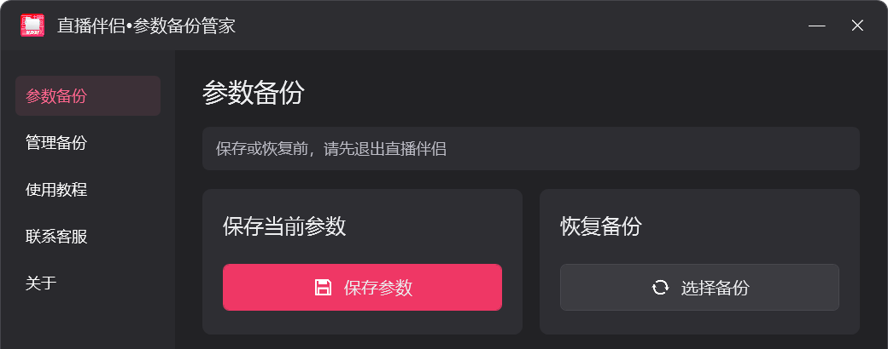

# 直播伴侣备份管家

用于在本机保存和恢复直播伴侣调试参数的 Windows 桌面工具。

**版本：0.4.6 · 源码可见 · 仅限许可范围内的非商业使用**



## 功能

- 保存输入、直播编码、音频、美颜、独立调色等已适配的本地参数。
- 打包引用的 LUT；图片、视频、音频仍沿用原路径。
- 在「管理备份」中选择目录、查看、恢复或确认删除备份。
- 可选加入用户自行导出的官方预设附件，默认不加入。
- 提供图文教程、客服入口和用途声明。
- 工具箱支持按需打开用户自行准备的第三方工具。

目前重点是**同一台电脑上的备份和恢复**。源码保留设备映射与迁移逻辑，但跨电脑功能仍在完善中，不保证不同设备、版本或驱动之间效果一致。

## 使用步骤

1. 在直播伴侣中完成调试，然后正常退出直播伴侣。
2. 在「参数备份」点击「保存参数」，填写名称并保存。
3. 需要恢复时，先退出直播伴侣，再到「管理备份」选择备份并恢复。
4. 看到完成提示后，启动直播伴侣并检查结果。

恢复不会替用户自动创建另一份备份。相机本体上的曝光等硬件设置不在本工具的备份范围。请保留原素材，妥善保管备份；备份可能包含设备名称、本地文件路径和用户设置。

## 构建

环境：64 位 Windows 10 / Windows 11，Windows PowerShell 5.1，以及系统 .NET Framework 4.x 的 C# 编译器和 WPF 程序集。脚本使用 `Framework64/v4.0.30319` 中的编译器，并引用 `System.IO.Compression.FileSystem.dll` 等程序集。不需要 npm、NuGet 或第三方构建库。

在仓库根目录执行：

```powershell
powershell.exe -NoProfile -ExecutionPolicy Bypass -File .\build.ps1
```

脚本先编译主程序并运行隔离自检，成功后生成安装程序：

```text
dist/v0.4.6/直播伴侣备份管家.exe
dist/v0.4.6/直播伴侣备份管家-安装-v0.4.6.exe
```

安装版支持选择专用安装文件夹、创建快捷方式和卸载；默认位于当前用户的本地应用目录。运行数据与备份位于安装目录的「数据」「备份」子目录。卸载保留用户数据。

如系统不在 C 盘，可调整 `build.ps1` 顶部的 `$framework` 路径。

### 界面预览与自检

```powershell
# 使用模拟配置编译预览程序，不读取真实直播伴侣参数
powershell.exe -NoProfile -ExecutionPolicy Bypass -File .\build.ps1 -Preview

# 对正式构建单独运行隔离自检
& '.\dist\v0.4.6\直播伴侣备份管家.exe' --self-test
```

预览输出在 `dist/preview/`。运行该目录的 EXE 使用测试配置。自检结果写入构建目录的 `self-test-result.txt`；异常详情写入 `last-error.txt`。不要将真实直播伴侣目录传给 `--ui-demo`，该模式会生成模拟配置。

## 第三方工具：公开源码包与个人完整版的区别

**本仓库不附带四个第三方 EXE、对应原图标或预打包的 tools.zip，也不包含它们的源码或再分发授权。** 默认仍能完整构建主管家、备份/恢复功能和安装程序；未附带的工具按钮禁用，并使用项目图标占位。

如果您已获得相应使用及分发许可，可在本地补齐：

```text
src/assets/tools/采集卡改名.exe
src/assets/tools/OBS改名.exe
src/assets/tools/OBS蒙版.exe
src/assets/tools/虚拟显示器.exe
```

可选原图标路径依次为 `src/assets/tool0.png` 至 `tool3.png`，顺序与上述列表一致。重新构建后，存在的 EXE 才会被压缩内置，对应按钮启用；点击时按需解压。OBS 蒙版和虚拟显示器文件是安装程序，打开后进入其自身安装流程。

这些本地文件已被 `.gitignore` 忽略；不要用强制添加绕过忽略规则，除非已核实对应许可。现有个人完整版安装包包含这些程序，**公开发布该安装包也需要另外确认第三方授权**。详见 [第三方说明](THIRD_PARTY_NOTICES.md)。

## 源码结构

| 文件 | 作用 |
| --- | --- |
| `src/CompanionBackup.cs` | 入口、配置白名单、备份包校验、暂存写入与失败回滚、基础自检 |
| `src/ManagerWindow.cs` / `src/ui.xaml` | WPF 交互与界面 |
| `src/AppStorage.cs` / `src/BundleStore.cs` | 数据目录、备份目录和可选附件 |
| `src/Devices.cs` / `src/MigrationPlan.cs` | 设备枚举、实验性迁移 |
| `src/CompanionLauncher.cs` | 查找并启动直播伴侣 |
| `src/ToolBox.cs` | 可选第三方工具的校验、解压与启动 |
| `src/AdvancedTests.cs` | 隔离参数回归与可选工具测试 |
| `src/Setup.cs` | 安装与卸载 |
| `src/assets/` | 标识、教程截图及客服二维码 |

代码中的旧格式标记仅用于读取历史备份，不代表当前产品名。不要仅因字符串中出现旧标记就删除兼容逻辑。

## 数据与发布

本源码包不包含真实直播伴侣配置、账号数据、个人参数备份或官方原始备份 ZIP。演示截图使用示例目录和模拟参数。

客服二维码属于当前项目的联系素材，发布 fork 时请替换成您有权公开的联系信息，避免冒充原作者。项目标识、二维码和用户提供图片的权利说明见 [LICENSE_SCOPE.md](LICENSE_SCOPE.md)。

上传 GitHub 时上传源码包解压后的仓库内容即可；`dist/`、运行数据、备份和本地第三方工具不应进入源码仓库。仅发布 GitHub 源码仓库与发布预编译安装包是两件事。

## 许可与声明

项目原创代码采用 **PolyForm Noncommercial License 1.0.0**，见 [LICENSE](LICENSE)。这是限制商业用途的源码可见许可，不是允许任意商业使用的标准开源许可。商业使用或商业分发需向相应权利人另外取得授权；许可原文及范围说明优先于本摘要。

- 官方许可文本：[PolyForm Noncommercial 1.0.0](https://polyformproject.org/licenses/noncommercial/1.0.0)
- 署名：[NOTICE](NOTICE)
- 适用范围：[LICENSE_SCOPE.md](LICENSE_SCOPE.md)
- 第三方内容：[THIRD_PARTY_NOTICES.md](THIRD_PARTY_NOTICES.md)

本项目与抖音、直播伴侣、OBS 及第三方工具官方无隶属、认证或合作关系。相关名称与商标归各自权利人所有。若展示或收录内容涉嫌侵权，请通过软件的「联系客服」反馈，我们将核实并删除、下架或调整相关内容。

Create by @Gassy,@EktarTee
